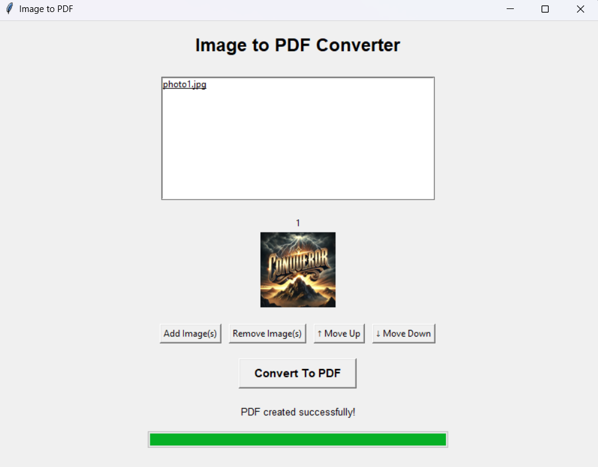

# ImageToPDF

A Python desktop application that converts images into pdf documents.

## Screenshot

## Features

- Select images from your computer
- Organise images before conversion
- Convert images into a pdf document
- Simple graphical user interface built with Tkinter

## Built With

- Python
- Tkinter
- Pillow (PIL)

#####################
### Getting Started
#####################

### Prerequisites

- Python installed on your computer
- Pillow library

### Installation

1. Clone this repository:
   git clone https://github.com/Conqueror00/ImageToPDF.git

2. Navigate to the project directory:
    cd ImageToPDF

3. Install the required library:
    pip install Pillow

4. Run the application:
    python main.py

## What I've Learnt
- Building a graphical user interface with Tkinter
- Working with image files using Pillow
- Organising a python project
- Developing a practical desktop application

## Author:

Solomon Kusi

I’m a Computer Science student at Aston University interested in software engineering and artificial intelligence, with a focus on building practical, real-world software solutions.
